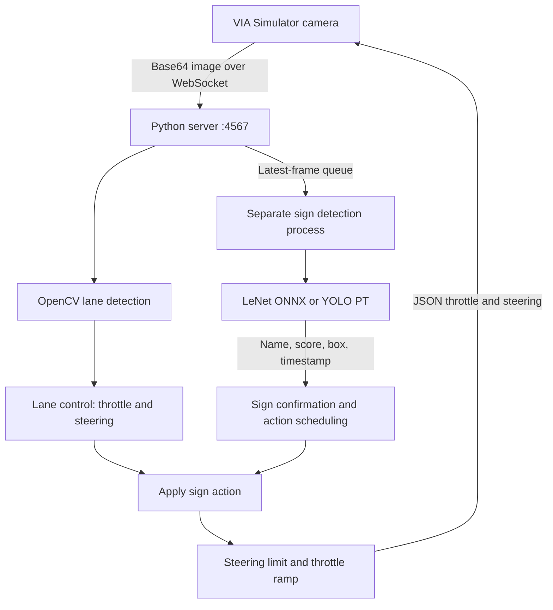

# 🚗 YOLO11 Traffic Sign Detection & Autonomous Lane Following

   

An end-to-end learning project for training a six-class traffic sign detector and combining sign recognition with autonomous lane following in the VIA Simulator.

Developed by **[danhyoyo](https://github.com/danhyoyo)**, based on the **[MakerViet VIA learning resources](https://github.com/makerviet/via-docs)**.

[](docs/media/car_yolo.mp4)

*Lane following and traffic sign control in VIA · [Watch the full demonstration](docs/media/car_yolo.mp4)*

## 📑 Table of Contents

- [Overview](#-overview)
- [Key Features](#-key-features)
- [System Architecture](#-system-architecture)
- [Supported Traffic Signs](#-supported-traffic-signs)
- [Project Structure](#-project-structure)
- [Installation & Quick Start](#-installation--quick-start)
- [Training & ONNX Export](#-training--onnx-export)
- [Operating Modes](#-operating-modes)
- [Control Logic & Guardrails](#-control-logic--guardrails)
- [Configuration Reference](#-configuration-reference)
- [Unit Testing](#-unit-testing)
- [Troubleshooting & FAQ](#-troubleshooting--faq)
- [Credits & Licensing](#-credits--licensing)

## 🌟 Overview

This repository connects computer vision, model training, and vehicle control into a complete simulator workflow. A Python WebSocket server receives camera frames from [VIA Simulator](https://via-sim.makerviet.org/), estimates the lane center, recognizes traffic signs, and returns throttle and steering commands.

The project supports two detection paths: an included legacy LeNet ONNX classifier and a YOLO11 detector trained through the provided notebook. YOLO performs full-frame object detection, while the lane controller uses OpenCV, normalized steering error, and proportional-derivative control.

Seven notebooks introduce Python/Colab, image processing, lane detection, sign recognition, classifier training, and YOLO11 training. This is a simulator and learning project; no physical vehicle integration or measured real-world driving performance is provided.

## 🚀 Key Features

- **Six-class sign recognition:** `left`, `no_left`, `right`, `no_right`, `straight`, and `stop`.
- **Two detector backends:** run the bundled LeNet classifier immediately or select trained YOLO `.pt` weights through an environment variable.
- **Adaptive lane following:** scan three image bands, estimate lane width, and use white markings with edge-based fallback.
- **Smooth vehicle commands:** limit steering changes over time and ramp up throttle after a stop.
- **Junction-aware turn scheduling:** remember confirmed turn signs until sustained lane loss suggests a junction.
- **Independent detection process:** bounded queues prioritize recent frames without waiting for inference in the lane-control loop.
- **Training and export workflow:** download Roboflow data, check annotations, train YOLO11s, evaluate, export ONNX, and package results.
- **Local verification:** tests cover lane control, sign handling, class mapping, sample images, and WebSocket communication.

## 🏗️ System Architecture



The detector submits its highest-scoring detection, or the largest box when scores are unavailable. The controller checks detection age and box area before accumulating evidence. Left/right turns wait for a junction cue; other supported signs use a short execution delay.

## 🚦 Supported Traffic Signs

| Class | Meaning | Controller behavior |
| --- | --- | --- |
| `left` | Turn left | Remember the sign, then apply left steering at sustained lane loss |
| `right` | Turn right | Remember the sign, then apply right steering at sustained lane loss |
| `straight` | Go straight | Restrict steering to ±0.18 and cap throttle at 0.48 |
| `stop` | Stop | Request zero throttle for 2.5 seconds |
| `no_left` | No left turn | Restrict left steering to −0.20 |
| `no_right` | No right turn | Restrict right steering to +0.20 |

Left/right actions request steering of ±0.72 and throttle of 0.25 for 1.1 seconds. All actions pass through the final steering limiter. These are timed control rules, not route planning or geometric junction recognition.

## 📁 Project Structure

```text
car-traffic-sign-detection-yolo/
├── simulator/                         # Camera processing and vehicle control
│   ├── drive.py                       # WebSocket server and sign action state
│   ├── lane_line_detection.py          # Lane estimation and bounded steering
│   ├── traffic_sign_detection.py       # Legacy detector and detection worker
│   ├── yolo_sign_detection.py          # YOLO adapter and class-name mapping
│   └── pid_controller.py               # PID controller utility
├── notebooks/                         # Learning and training notebooks
│   ├── 01_colab_basics.ipynb
│   ├── 02_opencv_basics.ipynb
│   ├── 03_image_filtering.ipynb
│   ├── 04_lane_detection.ipynb
│   ├── 05_sign_detection.ipynb
│   ├── 06_train_classifier.ipynb
│   └── 07_train_yolo11.ipynb
├── models/
│   ├── traffic_sign_classifier_lenet_v3.onnx  # Included legacy classifier
│   ├── pretrained/                    # Downloaded training weights (generated)
│   └── yolo11/                        # Exported models and mapping (generated)
├── data/
│   ├── samples/                       # Sample image archives
│   └── datasets/                      # Roboflow datasets (generated)
├── maps/                              # Three VIA traffic sign maps
├── tests/                             # Controller and YOLO adapter tests
├── docs/
│   ├── images/via_demo.gif            # Animated demonstration
│   ├── media/car_yolo.mp4             # Full demonstration
│   └── controller_tuning.md           # Vietnamese tuning notes
├── outputs/                           # Training/evaluation artifacts (generated)
├── requirements.txt                   # Simulator dependencies
├── requirements-train.txt             # Training/export dependencies
├── .env.example                       # API key configuration template
└── README.md
```

The training notebook creates generated directories as needed. Datasets, downloaded weights, exported YOLO models, and training outputs are excluded from Git. Sample archives are not the full training dataset.

## 🛠️ Installation & Quick Start

### 1. Prerequisites

- Python **3.10 or later**.
- A browser that can run VIA Simulator.
- A desktop display for the OpenCV preview windows.
- For training: a Roboflow private API key and access to the selected dataset.
- Optional: a CUDA-capable GPU or a Colab GPU runtime for faster training.

### 2. Clone the Repository

```powershell
git clone https://github.com/danhyoyo/car-traffic-sign-detection-yolo.git
cd car-traffic-sign-detection-yolo
```

### 3. Create a Python Environment

Windows PowerShell:

```powershell
python -m venv .venv
.venv/Scripts/Activate.ps1
python -m pip install -r requirements.txt
```

For training and ONNX export, install the extended dependencies instead:

```powershell
python -m pip install -r requirements-train.txt
```

The training requirements pin NumPy to **2.2.6**. Use a dedicated project environment to avoid conflicts with existing NumPy, MKL, or OpenMP installations. GPU training also requires a CUDA-enabled PyTorch installation.

### 4. Start the Controller and Connect VIA

```powershell
python -m simulator.drive
```

Open [VIA Simulator](https://via-sim.makerviet.org/), load a map from `maps/`, and connect to:

```text
ws://localhost:4567
```

The default run uses the included LeNet model. See [Operating Modes](#-operating-modes) to select YOLO. Press **Ctrl+C** in the terminal to stop the server.

## 🧠 Training & ONNX Export

### 1. Configure Dataset Access

Copy `.env.example` to `.env` and insert your Roboflow **Private API Key**:

```dotenv
ROBOFLOW_API_KEY=your_private_key
```

Get the key from [Roboflow API Settings](https://app.roboflow.com/settings/api). Keep `.env` out of shared files and version control.

### 2. Open the Training Notebook

Launch Jupyter:

```powershell
python -m jupyterlab
```

Open `notebooks/07_train_yolo11.ipynb`, select the project environment as the kernel, and run cells in order. On Colab, upload `.env` to `/content` and select a GPU runtime if available.

The configured dataset is **[trafficsign by Sa Tr](https://universe.roboflow.com/sa-tr/trafficsign-jryf1)**: workspace `sa-tr`, project `trafficsign-jryf1`, version `1`, identified in the notebook as **CC BY 4.0**.

### 3. Review Training Settings

| Setting | Notebook default |
| --- | --- |
| Model | `yolo11s.pt` |
| Epochs | 100 |
| Input image size | 640 |
| GPU batch size | 8 |
| Split seed | 42 |

The notebook checks class coverage and annotations before training. When validation data is missing, it builds an 80/10/10 train/validation/test split by source filename without moving originals. Augmented variants of the same source stay together, but nearby video frames with different source names can still cross splits. Review the split before reporting performance.

If GPU memory runs out, reduce batch size to **4** or **2**. Existing downloaded data is reused.

### 4. Export and Collect Artifacts

Step 12 exports and checks ONNX. Step 13 collects model files, class mapping, dataset configuration, and dependency versions under `models/yolo11/`:

```text
models/yolo11/
├── bien_bao_best.pt
├── bien_bao_best.onnx
└── sign_mapping.json
```

Detailed evaluation results and the packaged ZIP are saved under `outputs/`. Download the archive before ending a Colab session.

> **Model compatibility:** the exported YOLO ONNX model is a full-frame detector. It cannot replace the legacy 32×32 LeNet classifier directly. The simulator's YOLO integration currently selects `.pt` weights.

## 🎮 Operating Modes

### 1. Default LeNet Detection

Use the bundled classifier without training a YOLO model. To explicitly clear any YOLO override in PowerShell:

```powershell
Remove-Item Env:TRAFFIC_SIGN_MODEL -ErrorAction SilentlyContinue
python -m simulator.drive
```

### 2. YOLO Traffic Sign Detection

After training or copying exported weights into the project:

```powershell
$env:TRAFFIC_SIGN_MODEL = (Resolve-Path models/yolo11/bien_bao_best.pt).Path
python -m simulator.drive
```

Keep `sign_mapping.json` beside the `.pt` file. The adapter maps source labels by name, ignores unsupported classes, and warns when a model cannot supply all six controller classes. It also recognizes `cam_re_trai` and `cam_re_phai` as aliases for the two turn restrictions.

### 3. Notebook Learning & Experiments

Work through notebooks **01–06** for image processing, lane detection, and legacy classifier experiments. Use notebook **07** for YOLO training, evaluation, export, and prediction examples.

## 🛡️ Control Logic & Guardrails

- **Recent-frame processing:** the image queue holds one frame; the worker discards backlog and skips frames older than 0.5 seconds. The controller also rejects stale detection payloads.
- **Sign confirmation:** boxes must cover at least 2,800 pixels². A candidate is confirmed after three consistent detections **or** at least 0.1 seconds of accumulated observations.
- **Action latching:** a continuously visible confirmed sign does not repeatedly restart its action. A detection gap greater than 0.8 seconds allows the same sign to re-arm.
- **Pending turns:** left/right signs wait for at least 0.12 seconds of lane loss and expire after 15 seconds if no junction cue occurs.
- **Lane-loss behavior:** the lane controller requests zero throttle after 0.75 seconds without a reliable lane. An active sign turn can override that request with its own throttle.
- **Output limits:** final steering is limited to ±0.75, with a change rate of 2.6 units/second. Throttle acceleration is limited; reductions and zero-throttle requests apply immediately.

Zero throttle is a simulator command, not a separate braking command. These rules do not implement an independent hardware watchdog. Evaluate trained detections on VIA frames and verify closed-loop behavior on each map.

## 📖 Configuration Reference

There are no custom command-line flags. Select the detector through the environment and tune controller constants in the source files.

| Location | Parameter | Current default | Purpose |
| --- | --- | --- | --- |
| Environment | `TRAFFIC_SIGN_MODEL` | Included LeNet ONNX path | Select detector model; `.pt` selects YOLO |
| `drive.py` | WebSocket binding | `0.0.0.0:4567` | Simulator connection endpoint |
| `drive.py` | `MIN_BBOX_AREA` | 2800 | Minimum sign area accepted by control |
| `drive.py` | `MIN_CONSISTENT_DETECTIONS` | 3 | Observation-count confirmation threshold |
| `drive.py` | `CONFIRM_DELAY_SECONDS` | 0.1 | Alternative confirmation time threshold |
| `drive.py` | `EXECUTE_AFTER_SECONDS` | 0.3 | Delay for non-turn sign actions |
| `drive.py` | `JUNCTION_LOSS_SECONDS` | 0.12 | Lane-loss duration that triggers a pending turn |
| `drive.py` | `PENDING_TURN_TIMEOUT_SECONDS` | 15.0 | Pending turn expiry |
| `lane_line_detection.py` | `SCAN_ROWS` | `(0.84, 0.76, 0.68)` | Scan positions as fractions of image height |
| `lane_line_detection.py` | `STEERING_KP` / `STEERING_KD` | 1.7 / 0.025 | Steering control gains |
| `lane_line_detection.py` | `MAX_STEERING` | 0.75 | Final steering magnitude limit |
| `lane_line_detection.py` | `STEERING_RATE` | 2.6 | Steering change limit per second |
| `lane_line_detection.py` | `CRUISE_THROTTLE` | 0.60 | Lane controller cruise setting |
| `lane_line_detection.py` | `LOST_LANE_STOP_SECONDS` | 0.75 | Lane-loss stop threshold |
| `yolo_sign_detection.py` | `conf_threshold` | 0.45 | YOLO confidence threshold |
| `yolo_sign_detection.py` | `min_box_area` | 1200 | Detector-level box area filter |

The detector's 1,200-pixel² filter and controller's 2,800-pixel² acceptance threshold serve different stages. Passing the detector filter does not automatically trigger an action.

See [Vietnamese controller tuning notes](docs/controller_tuning.md) for background. Some example values there differ from current source constants; use the values in the Python files when tuning a run.

## 🧪 Unit Testing

Run from the repository root:

```powershell
python -m unittest discover -s tests -v
```

Coverage includes synthetic roads at multiple resolutions, sample lane images, noisy/partial lanes, lane loss, steering changes, repeated signs, junction scheduling, YOLO label mapping, and local WebSocket exchange.

The previously recorded local result was **22 passed out of 24**, with two controller tests disagreeing with the current turn settings. This is a historical result, not a claim that all tests pass on the current environment. Automated checks do not replace a closed-loop simulator run or establish trained detector accuracy.

## ❓ Troubleshooting & FAQ

### Why is YOLO not used after training?

The server defaults to LeNet. Set `TRAFFIC_SIGN_MODEL` to the exported `.pt` file before starting the server. Confirm the path exists and keep its mapping file alongside it.

### Can I point the controller at the exported YOLO ONNX file?

The current backend selection routes `.pt` files to YOLO and other paths to the legacy classifier. Use `bien_bao_best.pt` for driving; the YOLO ONNX export needs a compatible detector integration.

### VIA cannot connect to the controller.

Start the server from the project root and connect VIA to `ws://localhost:4567`. Check that port 4567 is available and local firewall settings allow the connection. When using a different computer for VIA, use the server computer's address instead of `localhost`.

### The car sees a turn sign but does not turn immediately.

Confirmed left/right signs are remembered until sustained lane loss suggests a junction. Check `Wait` and `Active` in the `Result` window. A pending turn expires after 15 seconds.

### The detector sees a sign, but the controller ignores it.

Check the mapped class name, box area, observation consistency, and frame age. The controller requires a larger box than the YOLO adapter and rejects results older than 0.5 seconds.

### Training runs out of GPU memory or the notebook kernel crashes.

Reduce the batch size to 4 or 2. For runtime conflicts, select the dedicated project environment and reinstall its training requirements. Check that the notebook kernel uses the same environment where dependencies were installed.

### Where are the trained YOLO weights?

YOLO exports are generated locally under `models/yolo11/` and excluded from Git. Run notebook 07 or copy a previously exported model package into that directory.

## 📜 Credits & Licensing

- **Project development:** [danhyoyo](https://github.com/danhyoyo).
- **Simulator and learning resources:** [MakerViet VIA](https://github.com/makerviet/via-docs).
- **YOLO training and inference:** [Ultralytics](https://github.com/ultralytics/ultralytics).
- **Dataset:** [trafficsign by Sa Tr](https://universe.roboflow.com/sa-tr/trafficsign-jryf1), identified in the training notebook as CC BY 4.0; preserve dataset attribution and accompanying terms.

This repository currently has no project-level `LICENSE` file. Consult the respective licenses for dependencies, datasets, pretrained weights, and upstream materials before redistribution or reuse.
