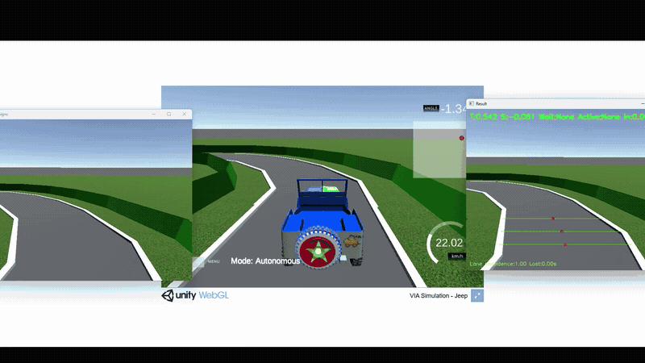

# Traffic Sign Detection — YOLO11 & VIA

Huấn luyện YOLO11s nhận diện 6 biển báo và điều khiển xe trong [VIA Simulator](https://via-sim.makerviet.org/).

Phát triển bởi **[danhyoyo](https://github.com/danhyoyo)**, dựa trên tài liệu [MakerViet VIA](https://github.com/makerviet/via-docs).

## Demo

[](docs/media/car_yolo.mp4)

GIF xem trước · [Xem video đầy đủ (MP4)](docs/media/car_yolo.mp4)

## Cấu trúc dự án

```text
car-traffic-sign-detection-yolo/
├── simulator/              # Code điều khiển xe và nhận diện biển
│   ├── drive.py
│   ├── lane_line_detection.py
│   ├── traffic_sign_detection.py
│   ├── yolo_sign_detection.py
│   └── pid_controller.py
├── tests/                  # Kiểm thử điều khiển và ánh xạ YOLO
├── notebooks/              # Notebook 01–07, từ cơ bản đến train YOLO
├── models/
│   ├── traffic_sign_classifier_lenet_v3.onnx  # Bộ phân loại cũ
│   ├── pretrained/         # Trọng số tải về khi train
│   └── yolo11/             # Mô hình PT, ONNX và ánh xạ xuất sau train
├── data/
│   ├── samples/            # ZIP ảnh mẫu có sẵn
│   └── datasets/           # Dataset tải từ Roboflow
├── outputs/                # Kết quả train, đánh giá, dự đoán và ZIP
├── maps/                   # Bản đồ VIA
├── docs/
│   ├── images/             # Hình minh họa và GIF demo
│   ├── media/              # Video demo đầy đủ
│   └── controller_tuning.md
├── requirements.txt        # Thư viện chạy simulator
├── requirements-train.txt  # Thư viện train và xuất ONNX
├── .env                    # API key cá nhân, không đưa lên Git
└── .env.example            # Mẫu cấu hình có thể chia sẻ
```

`data/datasets/`, `outputs/`, `models/pretrained/` và `models/yolo11/` được tạo khi chạy notebook và được Git bỏ qua. Tên thư mục dùng chữ thường, không khoảng trắng; tên file Python dùng `snake_case`.

## Cài đặt

Chạy từ thư mục gốc dự án, dùng Python 3.10 trở lên:

```powershell
python -m venv .venv
.venv/Scripts/Activate.ps1
python -m pip install -r requirements-train.txt
```

Trong Jupyter/VS Code, chọn kernel `.venv/Scripts/python.exe`. Môi trường `.venv` đã chuẩn bị trên máy hiện tại kế thừa thư viện CUDA từ `AI` và dùng NumPy 2.2.6 wheel riêng để tránh xung đột MKL/OpenMP. Khi clone sang máy khác, dùng cách tạo môi trường mới ở trên.

Nếu chỉ chạy xe: cài `requirements.txt`. Train GPU cần PyTorch hỗ trợ CUDA; có thể dùng Colab GPU.

## Train và xuất ONNX

1. Mở `notebooks/07_train_yolo11.ipynb` bằng Jupyter hoặc Colab.
2. Lấy **Private API Key** tại [Roboflow API Settings](https://app.roboflow.com/settings/api), điền vào `.env`:

```dotenv
ROBOFLOW_API_KEY=your_private_key
```

3. Chạy notebook từ trên xuống. Trên Colab, tải `.env` lên `/content`.

Dataset: [trafficsign — Sa Tr](https://universe.roboflow.com/sa-tr/trafficsign-jryf1), workspace `sa-tr`, project `trafficsign-jryf1`, version `1`, CC BY 4.0. Các lớp: `left`, `no_left`, `right`, `no_right`, `straight`, `stop`. Notebook kiểm tra đủ nhãn và mẫu train/validation trước khi huấn luyện. Nếu bản tải về chỉ có train, notebook tạo danh sách train/validation/test theo nhóm tên ảnh nguồn (80/10/10, seed 42), giữ các bản tăng cường cùng nguồn trong một tập và không di chuyển ảnh gốc.

Cấu hình tập trung ở bước 2: YOLO11s, 100 epoch, ảnh 640, batch 8 trên GPU. Hết bộ nhớ thì giảm batch xuống 4 hoặc 2.

Bước 12 xuất và kiểm tra ONNX; bước 13 lưu vào `models/yolo11/`:

- `bien_bao_best.pt`
- `bien_bao_best.onnx`
- `sign_mapping.json`, cấu hình dữ liệu và phiên bản thư viện

Kết quả chi tiết và ZIP nằm trong `outputs/`. Tải ZIP về trước khi kết thúc Colab. Không đưa API key vào notebook hoặc file chia sẻ.

## Chạy mô phỏng

```powershell
python -m simulator.drive
```

Mặc định dùng bộ phân loại LeNet trong `models/`. Để dùng YOLO đã train:

```powershell
$env:TRAFFIC_SIGN_MODEL = (Resolve-Path models/yolo11/bien_bao_best.pt).Path
python -m simulator.drive
```

Giữ `sign_mapping.json` cạnh trọng số. Bộ đọc YOLO ánh xạ theo tên lớp và bỏ qua lớp không hỗ trợ. YOLO ONNX là detector toàn ảnh, không thay trực tiếp cho bộ phân loại LeNet 32×32; phần điều khiển hiện dùng `.pt` khi chạy YOLO.

Mở VIA, nạp bản đồ trong `maps/` và kết nối `ws://localhost:4567`. Dừng bằng **Ctrl+C**. Biển rẽ được ghi nhớ tới khi mất làn liên tục tại ngã rẽ; các ngưỡng nằm trong `simulator/drive.py` và `simulator/lane_line_detection.py`. Xem [hướng dẫn cân chỉnh](docs/controller_tuning.md).

## Kiểm tra

```powershell
python -m unittest discover -s tests -v
```

Bộ kiểm thử dùng ảnh tổng hợp, ảnh mẫu, trạng thái biển báo và kết nối WebSocket. Cần đánh giá mô hình trên camera VIA trước khi dùng cho điều khiển; bộ dữ liệu đủ tên lớp chưa chứng minh độ chính xác trong mô phỏng.